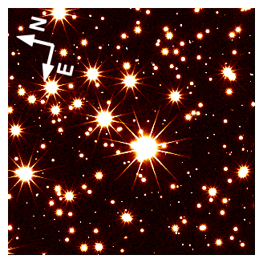

Generating Static Previews
==========================

Roman archiving requires static preview images for viewing and selecting images, with the
following requirements for each ``ImageModel``:

- 1080p x 1080p preview image
- 300p x 300p thumbnail image
- output as PNG files
- linear histogram stretch spanning the central 96% (preview) or 98% (thumbnail) of pixel values
- using ``afmhot`` colormap
- overlay indicating orientation

The ``roman_static_preview`` script creates downsampled images from ASDF files containing
an ``ImageModel``, with an optional compass rose overlaid onto the image indicating orientation.

Installation
------------

The requirements for this script are not installed by default as part of ``romancal``; install with
the ``sdp`` extra to include them.

.. code-block:: shell

	pip install "romancal[sdp]"

Usage
-----

``roman_static_preview`` includes two convenience commands, ``preview`` and ``thumbnail``, that set
default options to the static preview requirements.

.. code-block:: shell

	❯ roman_static_preview input.asdf output.png preview --help
	usage: roman_static_preview INPUT OUTPUT preview [-h] [--percentile PERCENTILE] [--no-compass]
	                                                 SHAPE [SHAPE ...]

	positional arguments:
	  SHAPE                 desired pixel shape of output image

	options:
	  -h, --help            show this help message and exit
	  --percentile PERCENTILE
	                        central percentage of pixel values spanned by the color stretch (default:
	                        96, i.e. from the 2nd to the 98th percentile)
	  --no-compass          do not draw a north arrow on the image

.. code-block:: shell

	❯ roman_static_preview thumbnail --help
	usage: roman_static_preview INPUT OUTPUT thumbnail [-h] [--percentile PERCENTILE] [--compass]
	                                                   SHAPE [SHAPE ...]

	positional arguments:
	  SHAPE                 desired pixel shape of output image

	options:
	  -h, --help            show this help message and exit
	  --percentile PERCENTILE
	                        central percentage of pixel values spanned by the color stretch (default:
	                        98, i.e. from the 1st to the 99th percentile)
	  --compass             draw a north arrow on the image

The color stretch spans the central 96% of pixel values for previews (from the 2nd to the
98th percentile) and 98% for thumbnails (from the 1st to the 99th percentile); pass
``--percentile`` to change it.

.. code-block:: shell

	roman_static_preview input.asdf output.png preview --percentile 99 1080 1080

Examples
--------

.. code-block:: shell

	roman_static_preview r0000501001001001001_0001_wfi01_cal.asdf r0000501001001001001_0001_wfi01_cal.png preview 400 400

.. code-block:: shell

	roman_static_preview r0000501001001001001_0001_wfi01_cal.asdf r0000501001001001001_0001_wfi01_cal_thumb.png thumbnail

.. image:: ../images/r0000501001001001001_0001_wfi01_cal_thumb.png
   :alt: thumbnail of Roman imagery

using ``stpreview`` directly
----------------------------

The ``roman_static_preview`` script is merely a wrapper over ``stpreview INPUT OUTPUT to SHAPE``,
filling in defaults for previews and thumbnails. ``stpreview`` offers the ``to`` and ``by`` commands
(for resampling ``to`` a desired image shape, or ``by`` a desired factor, respectively).
Refer to `its documentation <https://github.com/spacetelescope/stpreview#usage>`_ for usage instructions.
